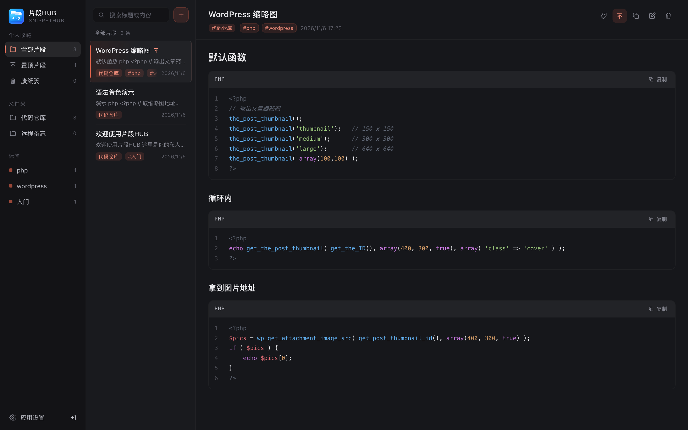
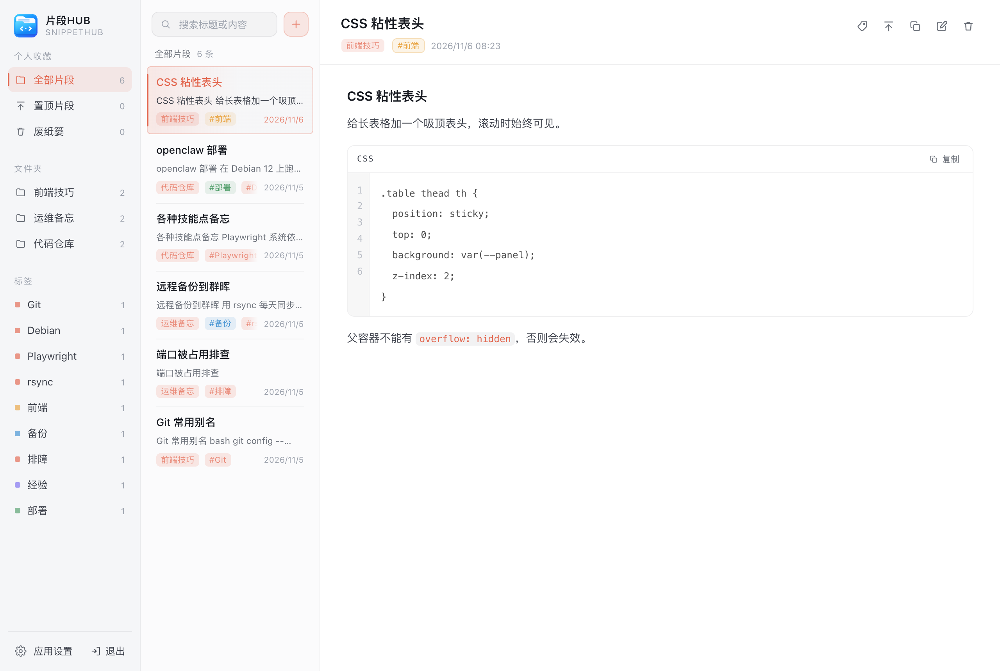
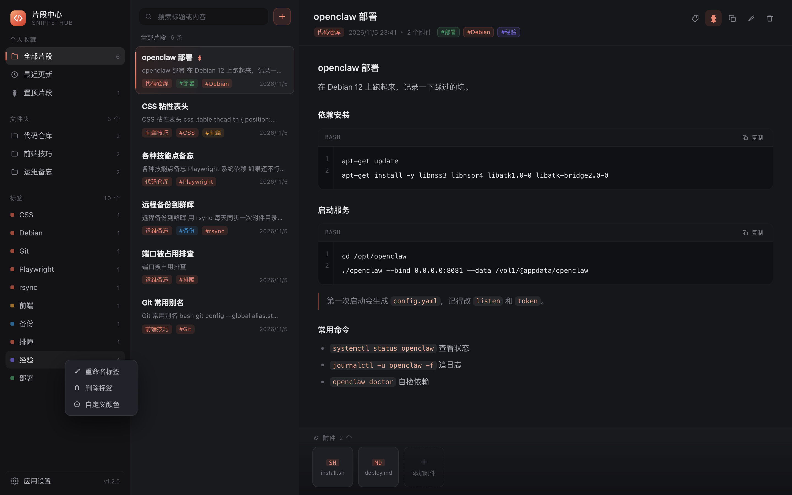
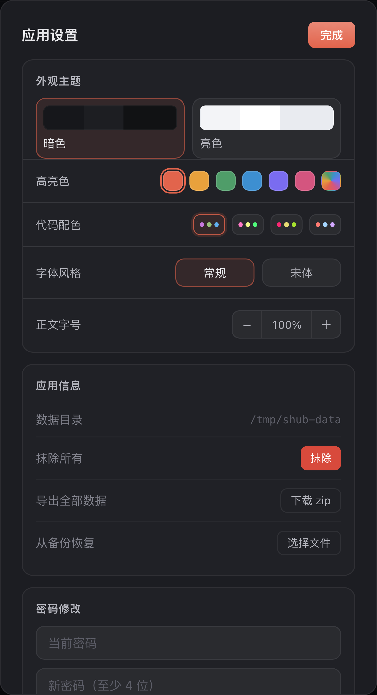
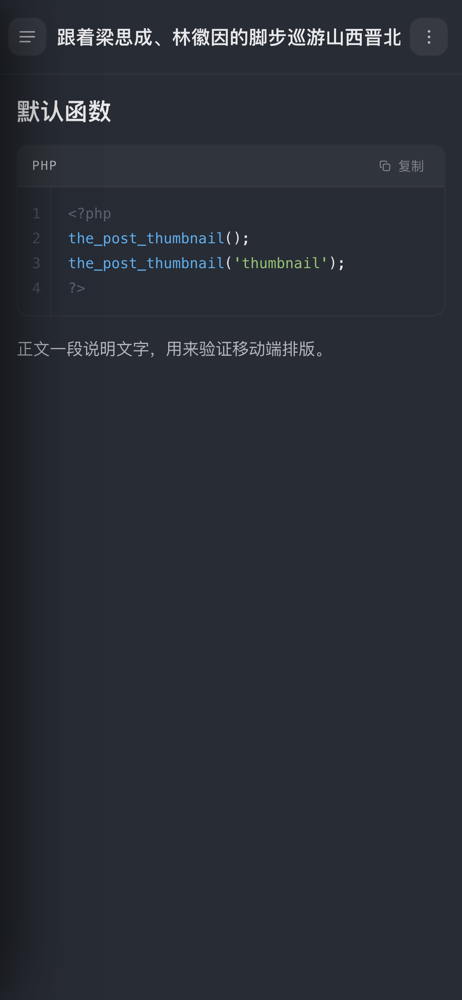
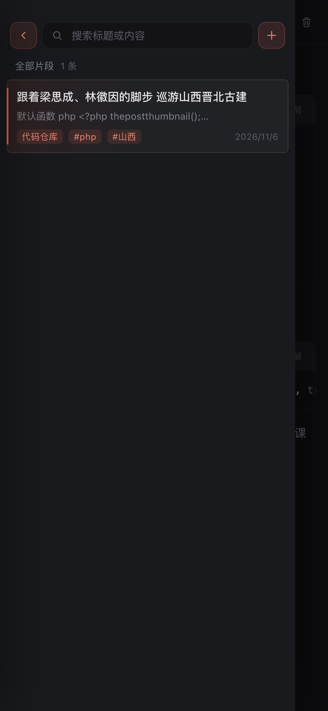
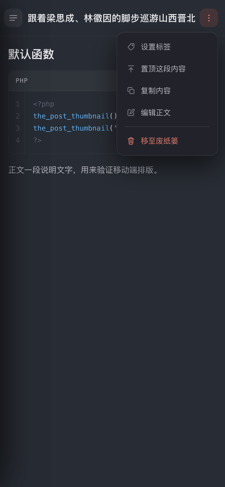
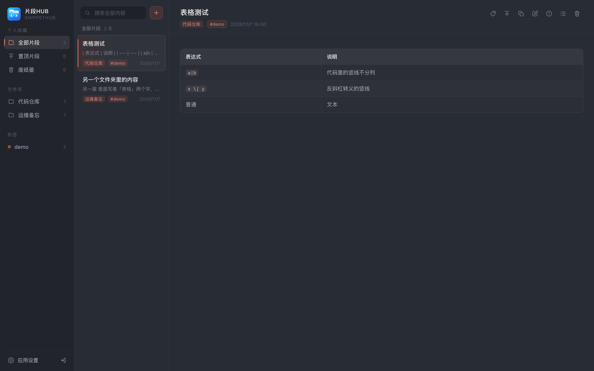
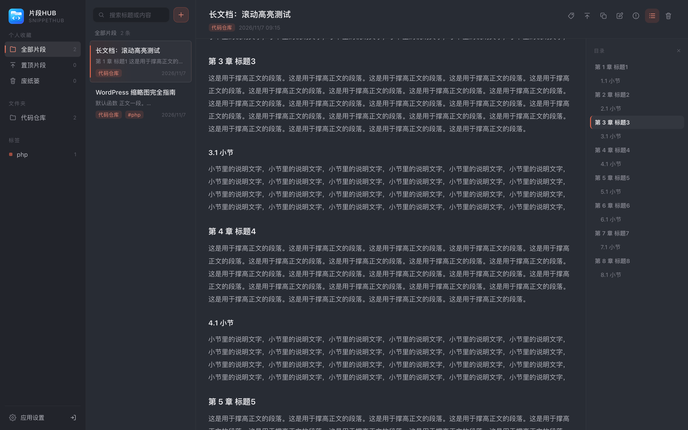
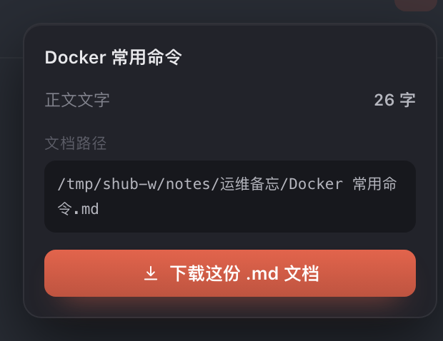

# 片段HUB · SnippetHub

一款 NAS 原生应用：把**代码片段**、**文字教程**、**踩坑笔记**按文件夹和标签归档，支持带行号的 Markdown 代码块、附件上传、亮/暗主题与整库备份。所有数据只存在你自己的 NAS 上。

- 开发者 / 作者：**疯狂的大叔**
- 项目主页：<https://github.com/HUiTHEME/SnippetHub_TOS>
- 当前版本：**1.0.0**
- 支持平台：**铁威马 TerraMaster TOS 7**
  - 安装包：`dist/tos/snippethub_<platform>.deb`（Debian 包，`x86_64` / `aarch64` 各一个）
  - 安装位置：`/usr/local/snippethub/`，由 systemd 管理，页面从 `/<appid>/` 进入
  - 打包与平台对接细节见 [tos/README.md](tos/README.md)



<details>
<summary>亮色主题 / 标签编辑 / 应用设置 / 手机端</summary>











</details>

## 功能

| 区域 | 说明 |
| --- | --- |
| 左侧文件夹栏 | 全新安装是空白开局（不预置示例）；没有文件夹时这里会显示「＋ 新建文件夹」引导；顶部是「全部片段 / 置顶片段 / 废纸篓」三个快捷视图；中间是文件夹（**右键**新建 / 重命名 / 删除），下半部分是标签汇总（右键可重命名 / 删除 / 自定义颜色）；**长按拖动文件夹或标签可调整顺序，松手自动保存**；左下角为「应用设置」与退出登录图标 |
| 中间列表 | 当前片段标题、摘要、所属文件夹、标签与时间，条目之间有淡分隔线；列表里的**标签只作标记，点它不会跳去筛选**（点整行直接打开片段）；**右键片段**可置顶 / 移到废纸篓；顶部搜索框会**全文检索标题与正文**（含代码块里的代码），命中处高亮并显示所在行；**搜索是全局的**——不管当前停在哪个文件夹 / 标签，都会跨全部内容找，列表标题变成「搜索结果」；`+` 新建片段 |
| 右侧内容区 | 标题 + Markdown 正文；右上角一排图标按钮（编辑 / 目录 / 标签 / 复制 / 文档信息 / 置顶 / 删除），**鼠标放上立刻在图标下方居中显示提示文字**；**长按图标可以左右拖动排序**，松手自动保存（每台设备各自记住，单击仍是原来的功能） |
| 目录 | 正文右上角「☰」开关，右侧按标题层级生成 TOC：点标题跳转、滚动时自动高亮当前章节（标题过长单行显示、末尾省略，悬停可看全文）；开启后全局记忆，换一篇也自动展开（手机端从右侧滑出浮层） |
| 文档信息 | 正文右上角「!」：正文字数、这份片段在磁盘上的**真实路径**（`notes/<文件夹>/<标题>.md`），以及下载该片段原样的 `.md` 文件（服务端直接读那个文件）；路径直接列在字数下面，不再单独加「文档路径」小标题 |
| 导出 / 打印 | 同一个浮层里：**导出为 HTML 文档**把正文按现有排版解析成一个独立的 `.html` 文件（白底单页、代码带语言标签与高亮、表格/引用/图片都在，不含应用界面）、**标题右侧的打印图标**直接把这份正文送去打印机（A4 版心留白、代码长行自动折行、代码块与表格不跨页拆开） |
| 代码块 | 标题栏显示语言名与**一键复制**，左侧行号；**highlight.js 语法高亮**，设置里可选「代码配色」（极夜 / 吸血鬼 / 复古 / 简白，明暗主题各自适配）；正文与代码块都按内容区**全宽**铺开 |
| 表格 | 支持标准 Markdown 表格：表头底色、斑马纹、细边框、圆角，`:` 控制左右/居中对齐；列多时表格自己横向滚动，不撑破正文 |
| 标签 | 文档头把标签排在分类之后（同一行不换行），点击标签直接筛出同类内容；侧栏「标签」默认按使用次数汇总，可自定义颜色、可拖动排序；单篇最多 12 个标签 |
| 底部附件条 | 有附件时显示方块卡片，**下载 / 删除按钮常驻**（只有编辑正文时才有删除）；文件名过长时**鼠标悬停会慢慢横向滚动**露出全名；没有附件且不在编辑态时整条隐藏 |
| 编辑正文 | 右上角可切**书写模式 / 预览模式**（每次编辑都从书写开始）：预览模式下两侧栏**平滑滑出收起**、正文一分为二（预览从右侧滑入，切换全程 60fps），左边写作右边**实时 Markdown 预览** |
| 编辑快捷键 | **Tab** 缩进 4 格 / **Shift+Tab** 反缩进（多行选中整块增减）；**回车自动续写**列表、有序列表、任务项与引用（空项回车退出列表）；**Ctrl/⌘+S** 保存并留在编辑态、**Ctrl/⌘+Enter** 保存并退出、**Ctrl/⌘+B / I / E / K** 加粗 / 斜体 / 行内代码 / 链接、**Ctrl/⌘+D** 复制当前行、**Alt+↑ / ↓** 上下移动行；选中文字后粘贴网址会自动变成 `[文字](网址)` |
| 编辑右键菜单 | 插入图片（可选文件或直接粘贴截图）、插入链接 / 代码块 / 表格、**标题 H1–H6**（当前行或选中多行一键设级别，同级再点一次取消，打开菜单时高亮光标所在行的级别）、加粗 / 斜体 / 行内代码，菜单右侧标着对应快捷键；**插入后不会再把光标甩到文末**，视野留在原处 |
| 登录 | 首次进入必须设置访问密码（需二次确认），之后每次进入都要输入密码。**打开应用先走一小段启动动画判定登录状态**：已解锁就直接缓缓浮出主界面，不会再"闪一下密码页"；未解锁则平滑切到密码页 |
| 恢复码 | 首次设置密码时生成一串一次性的恢复码，忘记密码时可凭它自助重设；可在设置里重新生成（设置里的「密码修改」默认收起，点标题右侧箭头展开） |
| 导入数据 | 设置 →「数据备份」→ 导入：选一个 zip 可**批量导入已有的 .md**（按文件夹归位，缺的文件夹自动创建、重名加 `(2)` 序号、绝不覆盖原有内容），也能恢复本应用的备份包（可选合并 / 覆盖）；导入前有操作引导与数量确认 |
| 抹除所有 | 设置 →「数据备份」点标题右侧箭头展开 → 抹除所有（**默认收起，怕误点**），需输入「抹除」二次确认，清空全部文件夹 / 片段 / 标签 / 附件并清除密码 |
| 外观 | 暗色 / 亮色两套主题，6 个预设高亮色 + 取色器自定义；字体可选「正常字体 / 宋体」；代码配色四选一；正文字号 80%–180% 可调；选择存在浏览器本地 |

其他细节：

- 置顶的片段在列表里永远排在最前面，侧栏「置顶片段」可以只看这些内容
- 删除只是**移到废纸篓**：正文和附件都还在，可以从废纸篓恢复；在废纸篓里再删一次（或「清空废纸篓」）才真正删掉文件
- 编辑时 `⌘/Ctrl + S` 保存，`Esc` 退出编辑
- **手机 / 窄屏（≤820px）**：默认只显示正文，点左上角 ≡ 一次把「分类 + 标题列表」两栏同时拉出来（分类 44vw、列表 56vw，正好铺满屏宽；点左上角 × 或安卓返回键收起）；长按文件夹 / 标签 / 片段等同右键菜单
- 手机端正文右上角只留一个「⋮」，标签 / 置顶 / 复制 / 编辑 / 移至废纸篓都在弹出的菜单里（废纸篓里则是恢复 / 彻底删除），标题因此有更多横向空间
- 保存前切走会自动暂存，切换失败会阻止离开，避免丢失输入
- 左下角是「应用设置」，右侧紧挨着**退出登录**按钮（只有图标，悬停显示提示）
- 浅色/暗色主题下选中文字都会用你设置的高亮色

## 数据存放位置

数据固定存在**一个**位置，应用内不提供「更换目录」：

| 内容 | 位置 |
| --- | --- |
| 片段索引 / 标签 / 设置（`db.json`） | `/usr/local/snippethub/data/db.json` |
| 每篇正文（`notes/<文件夹>/<标题>.md`） | `/usr/local/snippethub/data/notes/` |
| 附件 | `/usr/local/snippethub/data/files/<片段ID>/` |
| 程序本体 / 页面 | `/usr/local/snippethub/`（`bin/`、`webui/`） |

物理上 `/usr/local/snippethub` 落在 `/Volume<N>/@apps/snippethub/`，而 `data/`、`logs/` 不在 deb 的文件清单里，
所以**升级、卸载重装都不会动数据**。

- 位置的唯一来源是启动参数 `-data`，写在 `/usr/local/snippethub/snippethub.env`，
  改完 `systemctl restart snippethub` 即可。
- 之所以不提供界面上换目录：应用是以**非 root 的独立用户**运行的，别处目录的读写必须先由平台授权，
  而 TOS 的权限模型（`tmacl`）连 SSH 的 `setfacl` 都不认，界面上让人填路径只会一路报「没有权限」。
- `notes/<文件夹>/<标题>.md` 就是磁盘上的原始 Markdown，SMB 挂上去能直接看、直接改。

如果 `db.json` 因为断电等原因损坏，应用不会覆盖它，而是改名为 `db.json.broken-<时间>` 留着，并在日志里说明。

## 数据备份与导入

在「应用设置 → 数据备份」里：

- **导出全部数据**：生成 `snippethub-backup-YYYYMMDD-HHMM.zip`，内含
  - `notes/<文件夹名>/<标题>.md` —— 每篇正文的原始 Markdown，**和磁盘上的存放结构完全一致**，解压就是一个个分好类的 .md 文件
  - `snippets.json` —— 索引：文件夹、片段元信息（标题/标签/时间/预览/附件/`file` 路径）、标签颜色与排序
  - `attachments/<片段ID>/<附件ID>.<ext>` —— 附件原文件
  - `README.txt` —— 格式说明

- **导入数据**：点「导入」会先让你选一种导入方式（默认「通过系统备份包恢复」），再挑一个 zip。

  **① 通过系统备份包恢复**（默认选项）

  识别到 `snippets.json` 后，会让你选怎么导：

  - **合并**：保留现有内容，把备份里的内容追加进来；同名文件夹自动合并，不产生重复目录
  - **覆盖**：先清空现有文件夹与片段（含附件文件），再导入备份；访问密码不受影响。旧数据不是直接删除，而是整套挪到数据目录下的 `_replaced-<时间>/`，发现导错了还能把目录改回来

  **② 通过已有文档导入**（选中这一项后，才会出现下面的目录示意与导入规则）

  在电脑上按文件夹整理好，整个打成 zip：

  ```
  我的文档.zip
  ├─ 运维备忘
  │   ├─ ESXI 疑难杂症.md
  │   └─ 群晖迁移.md
  └─ 代码仓库
      ├─ Debian 建站.md
      └─ nginx 反代.md
  ```

  导入规则：

  - 文件夹**不存在就自动创建**，已存在就直接把文件放进去（不会多出一个同名目录）
  - 只读 `.md / .markdown`，图片、`txt`、`.DS_Store`、`__MACOSX` 之类会自动跳过
  - 文件夹取文件所在的那一层；不同上级下的同名文件夹会合并；直接摆在 zip 根目录的 `.md` 归入「未归类」
  - **纯增量，不覆盖**：标题重名会自动加 `(2)`、`(3)` 后缀，原有内容一个都不会丢
  - 导入前会先告诉你「识别到几篇文档、几个文件夹、哪些会被跳过」，确认后才写入
  - 单篇上限 8MB；**文件名编码会自动修**：Windows 旧压缩工具写出的 GBK 文件名（不打 UTF-8 标志位那种）会按 GBK 解回正常中文，压缩工具写在 extra field 里的 UTF-8 别名也会优先采用 —— 不需要再用 7-Zip 重打包

备份包**不包含访问密码**，因此可以放心分享或离线保存。包内是标准 zip，也可以直接用解压工具打开取文本。废纸篓里的内容也会一起备份，导入后仍在废纸篓中。

## 目录结构

```
SnippetHub_TOS/
├── src/                     # 全部业务代码（编译进单二进制、前端被 go:embed 内嵌）
│   ├── main.go              启动 / 路由 / socket
│   ├── api.go               HTTP 接口
│   ├── store.go             数据模型与持久化
│   ├── auth.go              密码、恢复码、会话
│   ├── exporter.go          备份导出 / 导入
│   ├── importmd.go          已有 .md 批量导入
│   ├── search.go  trash.go  tags.go  sort.go  recovery.go  reset.go
│   └── web/                 index.html / app.js / style.css / vendor/highlight.min.js
├── tos/                     # TOS 7 打包工程（见 tos/README.md）
│   ├── build.sh             编译 + 打 deb
│   ├── config.ini           平台元数据
│   ├── snippethub.lang      26 语言文案
│   ├── snippethub.env       systemd EnvironmentFile
│   ├── images/icons/        应用图标
│   ├── init.d/              systemd 单元
│   ├── DEBIAN/              control + postinst / prerm / postrm
│   └── preview.sh           侧载调试用（临时 nginx 预览路由）
├── tools/
│   ├── mkdeb.py             纯 Python 的 deb 打包器（macOS 上也能出标准 deb）
│   └── gen_gbk_table.py     生成 GBK 解码表
├── docs/                    界面截图
└── dist/tos/                构建产物
```

## 构建

需要 Go 1.21+ 和 python3：

```bash
./tos/build.sh x86_64      # 出 x86_64 包
./tos/build.sh aarch64     # 出 aarch64 包
./tos/build.sh all         # 两个都出，产物在 dist/tos/
```

脚本会先比对 `tos/config.ini` 的 `version` 与 `src/store.go` 的 `appVersion`，不一致直接报错。

> macOS 上没有 `dpkg-deb`，所以 `tools/mkdeb.py` 直接按 ar + tar.gz 的格式拼出标准 deb
> （`debian-binary` / `control.tar.gz` / `data.tar.gz`），不需要装任何额外工具。

## 安装

**方式一：应用中心**

把 `dist/tos/snippethub_x86_64.deb` 上传到 NAS，在「应用中心」里安装。

**方式二：命令行**

```bash
scp dist/tos/snippethub_x86_64.deb admin@<NAS_IP>:/tmp/
ssh admin@<NAS_IP>
sudo dpkg -i /tmp/snippethub_x86_64.deb
systemctl status snippethub
curl --unix-socket /var/api/snippethub.sock http://localhost/api/health
# {"ok":true,"version":"1.0.0"}
```

> 用 `dpkg -i` 侧载时，平台不会注册 `/<appid>/` 页面路由与 `/v2/proxy/` 代理（那是应用中心安装时生成的），
> 页面会 404 —— 调试可以先跑 `./tos/preview.sh on`，详见 [tos/README.md](tos/README.md)。

卸载（用户数据保留）：

```bash
dpkg -r snippethub        # 移除程序，data/ 留着
dpkg --purge snippethub   # 连程序目录一起清掉（data/ 同样保留）
```

## 运行方式

本应用作为 **TOS 桌面里的网页应用（iframe）** 使用，不提供独立端口的页面：

- 桌面出现「片段HUB」图标，点击即在窗口内打开（页面路径 `http://<NAS>:8181/snippethub/`）；
- 前端请求走平台代理 `/v2/proxy/snippethub/api/...`，由平台 nginx + API 网关转发到 `/var/api/snippethub.sock`；
- **不监听任何 TCP 端口**：进程只在 unix socket 上监听，所以同一台 NAS 装多个应用不会端口冲突；
- 页面顶部预留 40px 给窗口标题栏（TOS 的标题栏是浮在 iframe 之上的）。

### 运行身份与权限

- 应用用户是 `snippethub`，由 systemd 以该身份启动，**前台服务不是 root**；
- Go 代码里没有任何 `chown` / `chmod` / `sudo` / 提权调用，运行期不需要 root；
- 启动日志会打印 `running as uid=… gid=…`，`journalctl -u snippethub` 就能确认。

## 忘记访问密码

有三种方式，**都不会删除片段与附件**：

**① 用恢复码（推荐，自助）**

首次设置密码时会弹出一串形如 `ABCD-EFGH-JKLM-NPQR` 的恢复码，只显示一次。忘记密码时：

1. 打开应用，点密码框下方的「忘记密码？」；
2. 输入恢复码和新密码 → 密码立即重置，**并当场弹出新签发的恢复码界面**（旧码同时作废），确认保存后再用新密码登录。

恢复码**只用一次**，用掉即作废；重置成功时应用会自动生成并弹出新的一串，所以请把它截图或抄到安全的地方。也可以在「应用设置 → 密码修改 → 恢复码」里随时重新生成。

**② 命令行重置（兜底）**

如果恢复码也丢了：

```bash
sudo systemctl stop snippethub
sudo -u snippethub /usr/local/snippethub/bin/snippethub -reset-password -data /usr/local/snippethub/data
sudo systemctl start snippethub
```

重新打开应用即可再次设置密码。

**③ 抹除重来（最后手段）**

「应用设置 → 数据备份（展开）→ 抹除数据」会清空全部内容与密码，等于恢复出厂；数据无法找回，请先导出备份。

### 安全说明

- 密码与恢复码都只存 **PBKDF2-HMAC-SHA256（21 万轮）哈希**，服务端无法反推出原文，因此「把密码发给你」这种找回方式在技术上不存在；
- 恢复码是 16 位随机字符（约 80 bit），连续输错 5 次会锁定 5 分钟；登录连续输错也会逐次加长等待（10s 起，最长 5 分钟）；
- 会话是 HttpOnly + SameSite=Lax 的随机 token，改密码会把其它设备上的登录态全部作废；过期 token 每小时清一次，内存里最多留 256 个；
- 页面带 CSP（`script-src 'self'`，不允许内联脚本）与 `nosniff`；附件下载时 html / svg / xml 这类能跑脚本的类型强制 `attachment`，可内联预览的类型再加一层 `sandbox`；
- 应用只部署在你自己的 NAS 上，最终兜底永远是 NAS 的 SSH 权限。

## 技术说明

- 后端：Go 标准库单二进制，无外部依赖；备份读写用 `archive/zip`
- 存储：**索引与正文分离，正文按文件夹落盘**——`notes/<文件夹名>/<标题>.md`，一个片段就是一个 `.md` 文件（重名自动加 `(2)`，非法字符替换成 `_`），文件名跟着标题改、目录跟着文件夹走；`db.json` 只存索引（含每篇的 `file` 相对路径）与设置；附件在 `files/<片段ID>/`。保存一篇只写那一个文件，与内容总量无关，随便用编辑器打开 notes 目录就能读写；每次写盘都是「临时文件 → fsync → rename」，断电不会留下半篇或半份索引
- 搜索：`GET /api/search?q=` 在服务端遍历所有正文（全部正文在启动时预热进内存缓存，几百篇一次搜索约 5–10 ms），返回命中片段所在行的摘要；标题命中不额外读盘
- 下载单篇：`GET /api/docs/{id}/file` 直接把该片段在 `notes/` 下的那份磁盘文件发回（`Content-Disposition: attachment`，中文名走 RFC 5987），与备份包里的一模一样
- 鉴权：PBKDF2-HMAC-SHA256（21 万轮）存密码，HttpOnly Cookie 会话，30 天有效
- 前端：原生 JS + 自写 Markdown 渲染（标题 / 列表 / 引用 / 表格 / 代码块 / 行内样式），静态资源 `go:embed` 进二进制，随包单文件分发
- 代码高亮：内置 highlight.js 11.11.1（36 种常用语言，`src/web/vendor/highlight.min.js`，BSD-3-Clause），完全离线；配色只用 CSS 变量切换，改配色不需要重绘正文
- 端口：**不占用**。只有本地开发时才用 `-port` 走 TCP
- 权限：以应用用户 `snippethub` 运行，不使用 root

---

作者：疯狂的大叔 · <https://github.com/HUiTHEME/SnippetHub_TOS>
